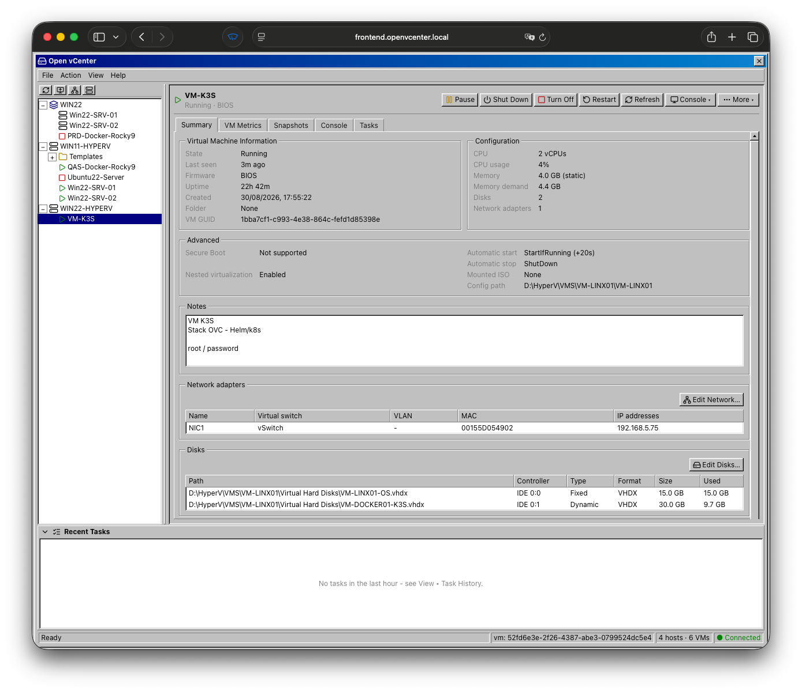
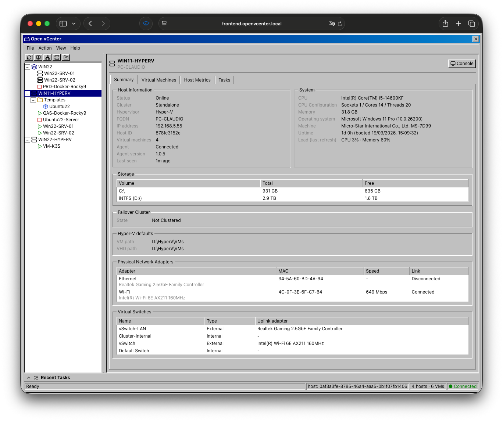

<h1 align="center">
  <a href="https://openvcenter.com/">
    
  </a>
</h1>

<p align="center">
  <strong>An open source virtualization center to manage hundreds of thousands of VMs</strong>
</p>

<p align="center">
  <a href="https://openvcenter.com">Website</a> ·
  <a href="https://demo.openvcenter.com/">Live Demo</a> ·
  <a href="https://openvcenter.com/docs/architecture/">Architecture</a> ·
  <a href="https://openvcenter.com/docs/running/">Run it</a> ·
  <a href="https://openvcenter.com/docs/docker-compose/">Docker Compose</a> ·
  <a href="https://openvcenter.com/docs/kubernetes/">Kubernetes</a> ·
  <a href="https://github.com/openvcenter/Open-vCenter/releases">Release Notes</a>
</p>

## Overview

Open vCenter (OVC) is a modern web console for managing VMs. It currently supports
**Microsoft Hyper-V** clusters, hosts and virtual machines: browse your inventory,
run VM lifecycle and power actions, edit hardware, manage templates and ISOs, and
open a VM console straight from the browser.

Tested on Windows 11, Windows Server 2022 and Windows Server 2025; should also work
on 2019/2016.

| Status       | Feature                                                |
| ------------ | ------------------------------------------------------ |
| ✅ Available | Creating and managing BIOS/UEFI VMs                    |
| ✅ Available | Disk and virtual NIC management                        |
| ✅ Available | Snapshots                                              |
| ✅ Available | Mounting / unmounting ISOs                             |
| ✅ Available | Autostart order                                        |
| ✅ Available | Batch start / stop                                     |
| ✅ Available | Basic CPU / memory / network metrics for VMs and hosts |
| ✅ Available | Remote HTML5 console to Windows/Linux VMs              |
| 🗓 Planned   | vTPM support                                           |
| 🗓 Planned   | vGPU management                                        |
| 🗓 Planned   | Cluster host affinity / anti-affinity                  |
| 🗓 Planned   | Automatic storage workload distribution (DRS-like)     |
| 🗓 Planned   | Non-Hyper-V hosts/agents                               |

---

## Screenshots

<p align="center">
  <strong>VM Selected &gt; Details Panel</strong><br>
  <br>
  <em>VM tree with the VM detail tabs on the right.</em>
</p>

<p align="center">
  <strong>Host Selected &gt; Details Panel</strong><br>
  <br>
  <em>VM tree with the Host detail tabs on the right.</em>
</p>

See [`docs/screenshots/`](docs/screenshots/) for more.

---

## How it works

OVC is a distributed system: a web frontend, a backend (REST API + worker), and a
lightweight agent running on every Hyper-V host. The frontend is the only REST
client; the backend never talks to a host directly - every operation is published to
RabbitMQ as a `Task` and picked up by that host's agent, which runs the work and
reports back asynchronously.

```
Browser ──REST──▶ ovc-frontend ──REST /api/*──▶ ovc-backend ──RabbitMQ──▶ ovc-agent (per host)
                                                     │
                                            PostgreSQL + Valkey
```

See **[Architecture](https://openvcenter.com/docs/architecture/)** for the full request
lifecycle, queues and task states.

---

## Components

Each component lives in its own repository:

| Component            | Role                                                                                | Repository                                                   |
| -------------------- | ----------------------------------------------------------------------------------- | ------------------------------------------------------------ |
| **ovc-frontend**     | React 19 / TanStack Start SSR web UI.                                               | https://github.com/openvcenter/Open-vCenter-Frontend     |
| **ovc-backend**      | FastAPI REST API **+** a RabbitMQ worker. Owns PostgreSQL and Valkey.               | https://github.com/openvcenter/Open-vCenter-Backend      |
| **ovc-agent-hyperv** | Go Windows service on every Hyper-V host. Executes the work, replies over RabbitMQ. | https://github.com/openvcenter/Open-vCenter-Agent-HyperV |

See **[Components](https://openvcenter.com/docs/components/)** for each repository's stack
and responsibilities in detail.

The **backing services** (PostgreSQL, RabbitMQ, Valkey, an OIDC provider, and
`guacd` for the browser consoles - `ovc-frontend` talks to it directly) are
ordinary containers you run yourself - see
**[Dependencies](https://openvcenter.com/docs/dependencies/)**.

---

## Running it

- **[Running in dev mode](https://openvcenter.com/docs/running/)** - local development
  stack and per-host agent setup.
- **[Docker Compose](https://openvcenter.com/docs/docker-compose/)** - the whole stack as
  containers, one compose file, using the published GHCR images.
- **[Kubernetes](https://openvcenter.com/docs/kubernetes/)** - the whole stack as plain
  manifests.

In both, the OIDC provider (Keycloak or any other) is optional.

---

## License

Licensed under the **Apache License 2.0** - see [`LICENSE`](LICENSE).

## Disclaimer

Open vCenter is an independent, community-driven open source project. It is
not affiliated with, endorsed by, sponsored by or supported by Microsoft,
VMware, Broadcom or any other vendor whose products it works with or is
compared to.

Microsoft, Windows, Windows Server and Hyper-V are trademarks of the Microsoft
group of companies. VMware, ESXi, vSphere, vCenter and vMotion are trademarks
of Broadcom Inc. and/or its subsidiaries. All other trademarks belong to their
respective owners.

The "vCenter" in the project's name refers to
the general idea of a virtualization management center, not to VMware's
product.

The software is provided "as is", without warranty of any kind - see
[`LICENSE`](LICENSE). Use it at your own risk, and try it on machines you can
afford to lose before trusting it with the ones you cannot.
